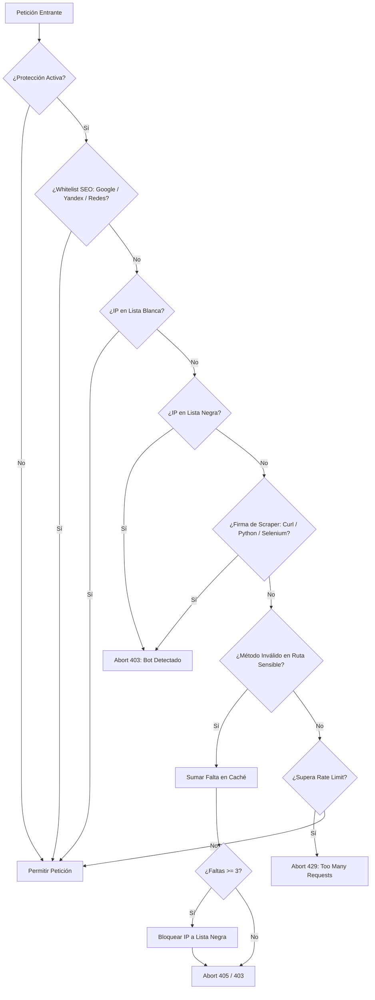

# 🛡️ Laravel BotProtection (Español)

<p align="center">
  <a href="https://packagist.org/packages/jlrodriguezdev/laravel-bot-protection"></a>
  <a href="https://php.net"></a>
  <a href="https://laravel.com"></a>
  <a href="LICENSE"></a>
  <a href="https://latiru.ru"></a>
</p>

> **Web Application Firewall (WAF) y Middleware Anti-Bots de Alto Rendimiento para Laravel**  
> *Probado en batalla y funcionando activamente en producción en [LATIRU.RU](https://latiru.ru).*

---

## 🌐 Otros Idiomas
* 🇬🇧 [English Version (README.md)](README.md)
* 🇷🇺 [Русская версия (README.ru.md)](README.ru.md)

---

### 1. Caso Real en Producción ([LATIRU.RU](https://latiru.ru))
El **22 de octubre de 2026**, durante la oleada masiva de ataques globales de **PHP2Shell (CVE-2026-109618 / CVE-2026-109619)**, nuestra plataforma en producción [LATIRU.RU](https://latiru.ru) fue bombardeada por bots automatizados que intentaban escanear y explotar el servidor:

```text
POST /php-cgi/php-cgi.exe?%ADd%20cgi.force_redirect%... -> 405 (Rechazado)
POST /api/gql                                           -> 405 (Rechazado)
POST /graphql/api                                       -> 405 (Rechazado)
GET  /.env                                              -> 404 (Protegido)
GET  /.git/config                                       -> 404 (Protegido)
GET  /.vscode/sftp.json                                 -> 404 (Protegido)
```

#### ¿Cómo lo frenó el sistema?
Tal y como quedó registrado en nuestro panel de **Laravel Telescope**:
1. El bot envió peticiones anómalas (`POST` a rutas sensibles).
2. El middleware acumuló las infracciones en caché (`method_violation:$ip`).
3. Al llegar a la 3ª infracción, **la IP fue enviada automáticamente a la lista negra permanente**.
4. Cualquier intento posterior del atacante a rutas públicas como `/`, `/events` o `/calc` fue **bloqueado de inmediato con `403 Forbidden` (`errors.bot-detected`)**, protegiendo la base de datos MySQL y los procesos de PHP sin intervención manual.

---

### 2. Características Clave
* **Neutralización de Scrapers y Herramientas Headless**: Bloquea de inmediato clientes automatizados (`curl`, `wget`, `python-requests`, `scrapy`, `selenium`, `webdriver`, `phantomjs`).
* **Lista Blanca Oficial para Motores de Búsqueda (SEO Friendly)**: Cero falsos positivos para rastreadores oficiales:
  - **Google**: `googlebot`, `google-inspectiontool`, `google-extended`.
  - **Yandex**: `yandexbot`, `yandeximages`, `yandexvideo`, `yandexsitelinks`, `yandexmarket`, `yandexaccessibility`.
  - **Bing**: `bingbot`, `bingpreview`, `msnbot`.
  - **Vistas previas**: TelegramBot, WhatsApp, TwitterBot, Facebot.
* **Sistema Progresivo de Infracciones (Strike System)**: Bloqueo permanente para atacantes que intenten inyecciones o métodos indebidos en rutas críticas.
* **Rate Limiting Contextual**: Límites de peticiones por minuto con respuesta limpia HTTP 429 (`errors.too-many-requests`).

---

### 3. Instalación

```bash
composer require jlrodriguezdev/laravel-bot-protection
```

Registrar en tu aplicación:

**Para Laravel 9 y 10 (`app/Http/Kernel.php`):**
```php
protected $middlewareGroups = [
    'web' => [
        // ...
        \Jlrodriguezdev\BotProtection\Middleware\BotProtection::class,
    ],
];
```

**Para Laravel 11 y 12 (`bootstrap/app.php`):**
```php
->withMiddleware(function (Middleware $middleware) {
    $middleware->web(append: [
        \Jlrodriguezdev\BotProtection\Middleware\BotProtection::class,
    ]);
})
```

Publicar configuración:
```bash
php artisan vendor:publish --provider="Jlrodriguezdev\BotProtection\BotProtectionServiceProvider"
```

> 💡 **Nota Importante sobre Pruebas y Whitelist**:  
> Si pruebas el middleware ejecutando `curl` directamente **desde la consola SSH de tu propio servidor**, la petición proviene de `127.0.0.1` o la IP pública de tu servidor. Dado que esas IPs están en la lista blanca (`whitelist_ips`) para evitar que los Cron jobs internos y comandos de consola se auto-bloqueen, el servidor responderá legítimamente `200 OK`.  
> Para verificar el bloqueo real en combate, lanza la prueba con `curl` desde una **máquina o laptop externa**:
> ```bash
> # Desde tu ordenador externo:
> curl -s -i -A "curl/8.4.0" "https://tudominio.com/"
> # Respuesta: HTTP 403 Forbidden ("errors.bot-detected")
> ```
> O pruébalo programáticamente con Tinker:
> ```bash
> php artisan tinker --execute="
> \$req = \Illuminate\Http\Request::create('/', 'GET', [], [], [], ['HTTP_USER_AGENT' => 'curl/8.4.0', 'REMOTE_ADDR' => '1.2.3.4']);
> \$res = app(\Jlrodriguezdev\BotProtection\Middleware\BotProtection::class)->handle(\$req, fn(\$r) => 'OK');
> echo 'Status: ' . (is_string(\$res) ? \$res : \$res->getStatusCode()) . PHP_EOL;
> "
> # Salida: Status: 403
> ```

---

### 4. Diagrama de Flujo



---

## 📄 Licencia
MIT License. Creado por [jlrodriguezdev](https://github.com/jlrodriguezdev).
