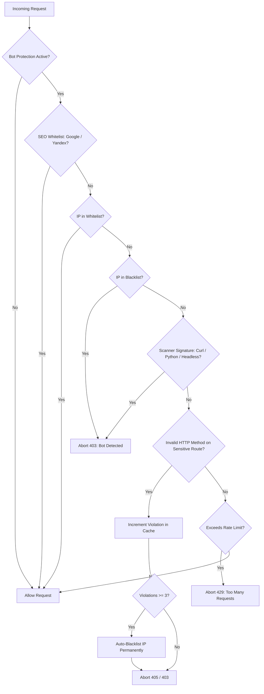

# 🛡️ Laravel BotProtection (Multi-Language: ES / EN / RU)
> **Comprehensive Web Application Firewall (WAF) & Automated Anti-Bot Middleware for Laravel Applications**  
> *Mitigates Automated Exploits, Scanners, AI Crawlers, and complements Infrastructure Hardening against PHP RCE threats (including PHP2Shell CVE-2026-109618 / CVE-2026-109619).*

---

## 🌐 Select Language / Выберите язык / Selecciona Idioma
* [🇪🇸 Español](#-español---laravel-botprotection)
* [🇬🇧 English](#-english---laravel-botprotection)
* [🇷🇺 Русский](#-русский---laravel-botprotection)

---

# 🇪🇸 Español - Laravel BotProtection

### 1. Descripción General
`BotProtection` es un middleware autónomo de alto rendimiento y cero dependencias para Laravel. Protege aplicaciones web contra scrapers maliciosos, bots de escaneo automatizado (frecuentes en ataques a gran escala como PHP2Shell) y peticiones anómalas, garantizando paso libre a rastreadores de motores de búsqueda oficiales (Google, Yandex, Bing).

### 2. Características Clave
* **Filtrado Avanzado de User-Agents**: Detecta y bloquea herramientas headless y clientes automatizados (`curl`, `wget`, `python-requests`, `scrapy`, `selenium`, `webdriver`, `phantomjs`).
* **Whitelist SEO Oficial**: Permite tráfico verificado de Googlebot, Yandex (yandexbot, yandeximages, yandexvideo, yandexsitelinks), Bingbot, y vistas previas de mensajería (Telegram, WhatsApp, Twitter).
* **Auto-Baneo Progresivo (Strike System)**: Monitorea rutas sensibles (`/`, `/api`, `/admin`). Si un cliente envía métodos no permitidos (`POST /`, inyecciones CGI o escaneo de dotfiles), acumula infracciones en Cache. A la 3ª infracción (`violations >= 3`), la IP se agrega a la lista negra permanente (`bot_blacklisted_ips`).
* **Protección Preventiva contra Escaneos de Exploits (PHP2Shell)**: En ataques masivos tipo PHP2Shell, los atacantes usan escáneres masivos para encontrar endpoints PHP desprotegidos. `BotProtection` detiene el escáner con HTTP 403 antes de que pueda iniciar la cadena de peticiones complejas de memoria.
* **Rate Limiting Contextual**: Límite por minuto con vista dedicada `errors.too-many-requests` (HTTP 429).

### 3. Instalación e Implementación
Registrar en `app/Http/Kernel.php`:
```php
protected $middlewareGroups = [
    'web' => [
        \App\Http\Middleware\BotProtection::class,
    ],
];
```

Configuración en base de datos (`SecuritySetting` o `settings`):
* `bot_protection_enabled`: `true` / `false`
* `bot_blacklisted_ips`: Array JSON de IPs bloqueadas permanentemente.
* `bot_whitelist_ips`: Array JSON de IPs de confianza.
* `rate_limit_requests`: Número máximo de peticiones por minuto (default: `60`).

---

# 🇬🇧 English - Laravel BotProtection

### 1. Overview
`BotProtection` is a zero-dependency, high-performance Laravel middleware designed to safeguard web applications against aggressive scrapers, vulnerability scanners, and automated bots. It acts as an application-level firewall (WAF), blocking reconnaissance scans used in exploits like **PHP2Shell (CVE-2026-109618 / CVE-2026-109619)** before malicious payloads reach the PHP runtime.

### 2. Key Features
* **Automated Scraper Neutralization**: Drops traffic from headless browsers, automated scripts, and exploitation suites (`curl`, `wget`, `python-requests`, `scrapy`, `selenium`, `webdriver`, `phantomjs`).
* **Official Search Engine Whitelist**: Zero false positives for legitimate search crawlers, including Googlebot, YandexBot suite, Bingbot, and social preview cards (Telegram, WhatsApp, Twitter, LinkedIn).
* **Strike-Based Permanent IP Blacklisting**: Enforces strict HTTP methods on root and critical routes (`/`, `/api`, `/admin`). Exploitation probes triggering method violations are tracked in Cache. Reaching 3 violations permanently blacklists the IP (`bot_blacklisted_ips`) with an instant HTTP 403 response.
* **Contextual Rate Limiter**: IP-based decay counters providing clean HTTP 429 responses under traffic bursts.
* **PHP2Shell Reconnaissance Shield**: While PHP core patches (PHP 8.2.35+, 8.3.36+, 8.4.27+, 8.5.12+) and disabling `session.upload_progress.enabled = Off` fix the low-level memory vulnerability, `BotProtection` cuts off automated scanners before they can map and trigger worker crashes.

### 3. Installation
Add to `app/Http/Kernel.php`:
```php
protected $middlewareGroups = [
    'web' => [
        \App\Http\Middleware\BotProtection::class,
    ],
];
```

Configuration keys (`SecuritySetting` table):
* `bot_protection_enabled`: Boolean toggle.
* `bot_blacklisted_ips`: JSON array of blocked IPs.
* `bot_whitelist_ips`: JSON array of trusted IPs.
* `rate_limit_requests`: Max requests per minute (default: `60`).

---

# 🇷🇺 Русский - Laravel BotProtection

### 1. Обзор
`BotProtection` — это автономный высокопроизводительный middleware для Laravel без внешних зависимостей. Защищает веб-сервер и приложение от вредоносных парсеров, автоматизированных сканеров уязвимостей и ботов. Служит фильтром прикладного уровня (WAF), пресекающим разведку и массовые сканирования, которые активно используются злоумышленниками при атаках **PHP2Shell (CVE-2026-109618 / CVE-2026-109619)**.

### 2. Основные возможности
* **Обнаружение и блокировка сканеров**: Моментальный сброс соединений от скриптов автоматизации и утилит (`curl`, `wget`, `python-requests`, `scrapy`, `selenium`, `webdriver`, `phantom`).
* **Белый список поисковых роботов (SEO Friendly)**: Полный пропуск официальных индексаторов без ложных срабатываний:
  - **Яндекс**: `yandexbot`, `yandeximages`, `yandexvideo`, `yandexsitelinks`, `yandexmarket`, `yandexaccessibility`.
  - **Google**: `googlebot`, `google-inspectiontool`, `google-extended`.
  - **Bing / Мессенджеры**: `bingbot`, `telegrambot`, `whatsapp`.
* **Автоматический бан по системе предупреждений (Strike System)**:
  - Защита чувствительных точек входа (`/`, `/api`, `/admin`).
  - При отправке запрещённых методов (например, `POST` на `/`, инъекции `php-cgi` или сканирование `.env` / `.git`) IP-адресу начисляется штраф в кэше.
  - При 3 нарушениях (`violations >= 3`) IP-адрес автоматически вносится в постоянный черный список (`bot_blacklisted_ips`) с выдачей `403 Forbidden` (`errors.bot-detected`).
* **Защита в контексте PHP2Shell**: Наряду с установкой официальных обновлений ядра PHP (8.2.35+, 8.3.36+, 8.4.27+) и отключением `session.upload_progress.enabled = Off`, `BotProtection` не позволяет автоматизированным сканерам находить уязвимые PHP-воркеры и провоцировать сбои памяти.

### 3. Быстрая установка
Зарегистрируйте в `app/Http/Kernel.php`:
```php
protected $middlewareGroups = [
    'web' => [
        \App\Http\Middleware\BotProtection::class,
    ],
];
```

Параметры в таблице настроек (`SecuritySetting`):
* `bot_protection_enabled`: Включение/выключение защиты.
* `bot_blacklisted_ips`: JSON-массив заблокированных IP.
* `bot_whitelist_ips`: JSON-массив доверенных IP.
* `rate_limit_requests`: Лимит запросов в минуту (по умолчанию: `60`).

---

## 📊 Flow Architecture / Архитектура работы



---

## 📄 License / Лицензия
MIT License. Tested and hardened in production under active hostile scanning.
