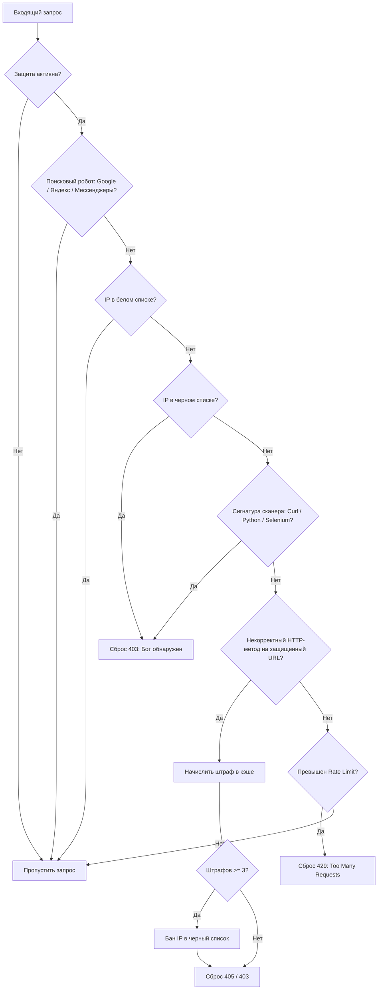

# 🛡️ Laravel BotProtection (Русский)

<p align="center">
  <a href="https://packagist.org/packages/jlrodriguezdev/laravel-bot-protection"></a>
  <a href="https://php.net"></a>
  <a href="https://laravel.com"></a>
  <a href="LICENSE"></a>
  <a href="https://latiru.ru"></a>
</p>

> **Высокопроизводительный Web Application Firewall (WAF) и Middleware для защиты Laravel от ботов**  
> *Проверен в боевых условиях и работает в продакшене на платформе [LATIRU.RU](https://latiru.ru).*

---

## 🌐 Другие языки
* 🇬🇧 [English Version (Default README.md)](README.md)
* 🇪🇸 [Versión en Español (README.es.md)](README.es.md)

---

### 1. Реальный кейс в продакшене ([LATIRU.RU](https://latiru.ru))
**22 октября 2026 года**, во время глобальной волны сканирований и атак **PHP2Shell (CVE-2026-109618 / CVE-2026-109619)**, наш боевой сервер [LATIRU.RU](https://latiru.ru) подвергся автоматизированному сканированию уязвимостей ботами:

```text
POST /php-cgi/php-cgi.exe?%ADd%20cgi.force_redirect%... -> 405 (Отклонено)
POST /api/gql                                           -> 405 (Отклонено)
POST /graphql/api                                       -> 405 (Отклонено)
GET  /.env                                              -> 404 (Защищено)
GET  /.git/config                                       -> 404 (Защищено)
GET  /.vscode/sftp.json                                 -> 404 (Защищено)
```

#### Как система остановила атаку:
По данным мониторинга **Laravel Telescope**:
1. Бот начал отправлять вредоносные запросы (`POST` на закрытые эндпоинты).
2. Middleware зафиксировал нарушения в кэше (`method_violation:$ip`).
3. При 3-м нарушении **IP-адрес злоумышленника был автоматически заблокирован на 24 часа**.
4. Все последующие попытки открыть публичные страницы (`/`, `/events`, `/calc`) мгновенно сбрасывались с кодом **`403 Forbidden` (`errors.bot-detected`)**, сохранив ресурсы воркеров PHP и базы данных MySQL.

---

### 2. Ключевые возможности
* **Блокировка парсеров и сканеров**: Отсекает запросы от headless-браузеров и утилит (`curl`, `wget`, `python-requests`, `scrapy`, `selenium`, `webdriver`, `phantomjs`).
* **Белый список поисковых систем (SEO Friendly)**: Полный пропуск официальных индексаторов:
  - **Яндекс**: `yandexbot`, `yandeximages`, `yandexvideo`, `yandexsitelinks`, `yandexmarket`, `yandexaccessibility`.
  - **Google**: `googlebot`, `google-inspectiontool`, `google-extended`.
  - **Bing**: `bingbot`, `bingpreview`, `msnbot`.
  - **Превью мессенджеров**: TelegramBot, WhatsApp, TwitterBot, Facebot.
* **Система штрафов (Strike System)**: Автоматический бан при попытке перебора чувствительных точек входа.
* **Адаптивный Rate Limiting**: Ограничение частоты запросов с понятным ответом HTTP 429 (`errors.too-many-requests`).

---

### 3. Установка

```bash
composer require jlrodriguezdev/laravel-bot-protection
```

Подключение в приложении:

**Для Laravel 9 и 10 (`app/Http/Kernel.php`):**
```php
protected $middlewareGroups = [
    'web' => [
        // ...
        \Jlrodriguezdev\BotProtection\Middleware\BotProtection::class,
    ],
];
```

**Для Laravel 11 и 12 (`bootstrap/app.php`):**
```php
->withMiddleware(function (Middleware $middleware) {
    $middleware->web(append: [
        \Jlrodriguezdev\BotProtection\Middleware\BotProtection::class,
    ]);
})
```

Публикация конфигурации и представлений:
```bash
php artisan vendor:publish --provider="Jlrodriguezdev\BotProtection\BotProtectionServiceProvider"
```

> 💡 **Важное примечание по тестированию и белому списку (Whitelist)**:  
> Если вы тестируете middleware командой `curl` прямо **из консоли SSH вашего собственного сервера**, запрос исходит от `127.0.0.1` или внешнего IP сервера. Поскольку эти IP-адреса находятся в белом списке (`whitelist_ips`), чтобы предотвратить блокировку локальных Cron-задач и очередей Laravel, сервер закономерно вернет `200 OK`.  
> Чтобы проверить реальную блокировку ботов в бою, отправьте запрос `curl` с **внешнего компьютера или ноутбука**:
> ```bash
> # С вашего рабочего ноутбука:
> curl -s -i -A "curl/8.4.0" "https://yourdomain.com/"
> # Ответ: HTTP 403 Forbidden ("errors.bot-detected")
> ```
> Или проверьте программно через Tinker:
> ```bash
> php artisan tinker --execute="
> \$req = \Illuminate\Http\Request::create('/', 'GET', [], [], [], ['HTTP_USER_AGENT' => 'curl/8.4.0', 'REMOTE_ADDR' => '1.2.3.4']);
> \$res = app(\Jlrodriguezdev\BotProtection\Middleware\BotProtection::class)->handle(\$req, fn(\$r) => 'OK');
> echo 'Status: ' . (is_string(\$res) ? \$res : \$res->getStatusCode()) . PHP_EOL;
> "
> # Результат: Status: 403
> ```

---

### 4. Архитектура работы



---

## 📄 Лицензия
MIT License. Разработано [jlrodriguezdev](https://github.com/jlrodriguezdev).
